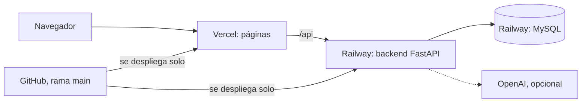

# Documentación de Empléate Jobmatch

Empléate Jobmatch conecta aspirantes y empresas: cada parte marca lo que le interesa y, cuando las dos dicen que sí a
la misma vacante, se crea un **match** y se comparten los datos de contacto.

La documentación está dividida en cinco guías. Puedes leerlas en orden o ir directo a la que necesites.

| Guía | Responde a |
|---|---|
| [1. Qué hace la app](docs/01-que-hace-la-app.md) | ¿Qué problema resuelve? ¿Qué puede hacer cada rol, paso a paso? ¿Cuáles son las reglas? |
| [2. Carpetas y archivos](docs/02-carpetas-y-archivos.md) | ¿Para qué sirve cada carpeta y cada archivo del proyecto? |
| [3. Cómo funciona por dentro](docs/03-como-funciona-por-dentro.md) | ¿Qué pasa al pulsar un botón? ¿Cómo funcionan la seguridad, la compatibilidad, la IA y la base de datos? |
| [4. Infraestructura y publicación](docs/04-infraestructura-y-publicacion.md) | ¿Dónde está publicada? ¿Cómo se conectan GitHub, Railway y Vercel? ¿Cómo se opera y qué hacer si algo falla? |
| [5. Trabajo local y cambios](docs/05-trabajo-local-y-cambios.md) | ¿Cómo la arranco en mi computador? ¿Cómo publico un cambio sin romper producción? |

Otros documentos:

- [README.md](README.md): presentación rápida del proyecto.
- [DESPLIEGUE.md](DESPLIEGUE.md): cómo crear la publicación desde cero en Railway y Vercel.

## Resumen en un minuto

| Pieza | Tecnología | Dónde vive |
|---|---|---|
| Páginas | HTML, CSS y JavaScript sin framework (`frontend/`) | Vercel |
| API | Python con FastAPI y SQLAlchemy (`backend/`) | Railway, con Docker |
| Base de datos | MySQL 8 | Railway |
| Hojas de vida | Archivos en disco | Volumen de Railway |
| IA (opcional) | OpenAI o Claude | Servicio externo |
| Código | Git | GitHub |

**La app:** https://empleate-jobmatch-frontend.vercel.app
