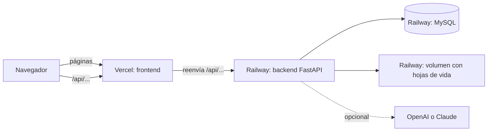
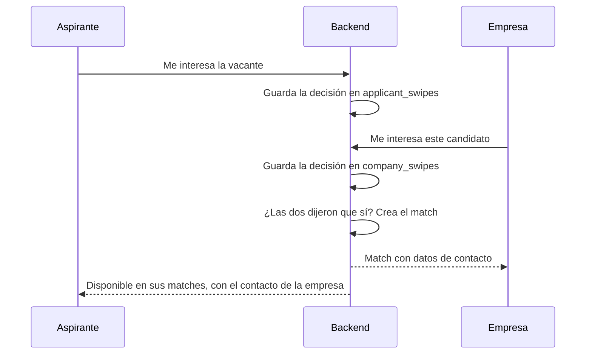
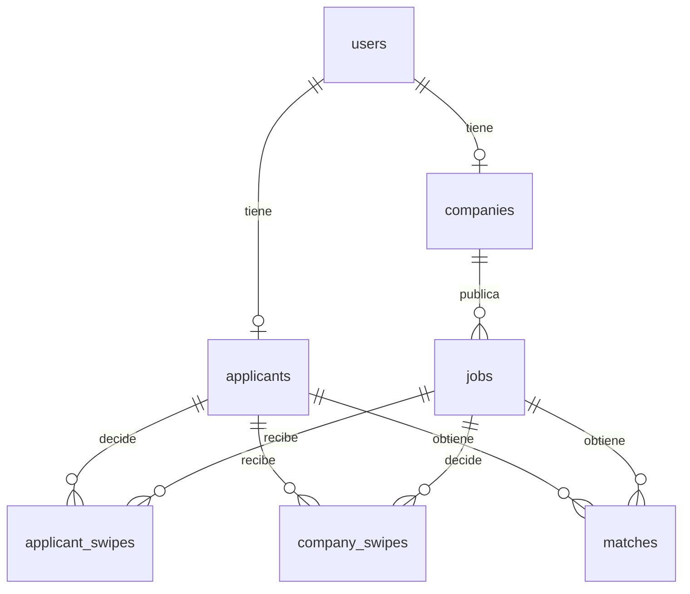

# Documentación de Empléate Jobmatch

Este documento explica qué hace el programa, cómo está construido y cómo se conectan sus partes. Para instalarlo
consulta el [README](README.md), y para publicarlo, [DESPLIEGUE.md](DESPLIEGUE.md).

## Contenido

1. [Qué es](#1-qué-es)
2. [Roles](#2-roles)
3. [Arquitectura](#3-arquitectura)
4. [Organización del código](#4-organización-del-código)
5. [Flujos principales](#5-flujos-principales)
6. [Cálculo de compatibilidad](#6-cálculo-de-compatibilidad)
7. [Inteligencia artificial](#7-inteligencia-artificial)
8. [Base de datos](#8-base-de-datos)
9. [API](#9-api)
10. [Seguridad y privacidad](#10-seguridad-y-privacidad)
11. [Configuración](#11-configuración)
12. [Pasar cambios a producción](#12-pasar-cambios-a-producción)
13. [Limitaciones conocidas](#13-limitaciones-conocidas)

## 1. Qué es

Empléate Jobmatch conecta aspirantes y empresas. El aspirante marca las vacantes que le interesan y la empresa marca
a los candidatos que le interesan para cada vacante. Cuando ambos dicen que sí, se crea un **match** y cada parte
recibe los datos de contacto de la otra.

Antes del match, la empresa ve el perfil profesional del aspirante, pero solo la inicial de su apellido, y no su
correo, su teléfono ni su hoja de vida.

## 2. Roles

| Rol | Cómo se crea | Qué puede hacer |
|---|---|---|
| **Aspirante** | Registro público | Subir su hoja de vida, editar su perfil, ver y buscar vacantes, marcar interés, ver sus matches y eliminar su cuenta |
| **Empresa** | Registro público | Editar su perfil, gestionar vacantes, revisar candidatos, ver sus matches, descargar hojas de vida tras el match y eliminar su cuenta |
| **Administrador** | `python -m scripts.create_admin correo@dominio.com` | Ver estadísticas, activar o desactivar cuentas, quitar bloqueos, deshabilitar vacantes, y consultar matches y actividad |

Al iniciar sesión, cada rol entra a su página:

- Aspirante: `pages/applicant/swipe.html`
- Empresa: `pages/company/jobs.html`
- Administrador: `pages/admin/dashboard.html`

## 3. Arquitectura



Hay tres piezas:

- **Frontend:** páginas que se ejecutan en el navegador. Muestran la información y llaman a la API.
- **Backend:** aplica las reglas, valida los datos, controla los permisos y habla con la base de datos.
- **Base de datos:** guarda la información de forma permanente. Los archivos subidos van en disco.

### Local y producción

Existen dos copias independientes de la aplicación:

| | En tu computador | En producción |
|---|---|---|
| **Dirección** | http://127.0.0.1:8000 | https://empleate-jobmatch-frontend.vercel.app |
| **Páginas** | Las sirve el mismo backend | Vercel |
| **Backend** | `uvicorn` en tu equipo | Railway |
| **Base de datos** | Tu MySQL local | MySQL de Railway |
| **Archivos** | `backend/uploads/` | Volumen de Railway en `/app/uploads` |
| **Configuración** | `backend/.env` | Variables de Railway |

Las dos bases de datos no están conectadas. Lo que se crea en una no aparece en la otra. **GitHub guarda el código,
no los datos.**

En producción, el navegador solo habla con Vercel. `frontend/vercel.json` reenvía las rutas `/api/...` al backend de
Railway. Por eso, para el navegador, las páginas y la API están en el mismo sitio. `frontend/assets/js/config.js`
calcula la dirección de la API a partir de la página abierta, de modo que funciona igual en local y en producción.

## 4. Organización del código

### Backend

Una petición pasa por estas capas:

```text
Controller  ->  Schema  ->  Service  ->  Model  ->  MySQL
```

| Capa | Carpeta | Responsabilidad |
|---|---|---|
| Controllers | `backend/app/controllers/` | Definen las rutas y quién puede usarlas |
| Schemas | `backend/app/schemas/` | Validan los datos que entran y salen |
| Services | `backend/app/services/` | Contienen las reglas del negocio |
| Models | `backend/app/models/` | Representan las tablas |
| Core | `backend/app/core/` | Contraseñas, tokens, permisos y errores |

Servicios principales:

| Archivo | Función |
|---|---|
| `auth_service.py` | Registro, inicio de sesión, bloqueo y recuperación de contraseña |
| `account_service.py` | Eliminación de cuentas |
| `applicant_service.py` | Perfil del aspirante y hoja de vida |
| `company_service.py` | Perfil y vacantes de la empresa |
| `job_service.py` | Tarjetas, búsqueda, decisiones del aspirante y sus matches |
| `candidate_service.py` | Candidatos, decisiones de la empresa, sus matches y descarga de hojas de vida |
| `matching_service.py` | Porcentaje de compatibilidad por reglas |
| `ai_matching_service.py` | Afinidad semántica y análisis con IA |
| `cv_parser_service.py` | Lectura de hojas de vida |
| `skill_service.py` | Catálogo y sugerencias de habilidades |
| `storage_service.py` | Guardado de archivos en disco |
| `email_service.py` | Envío de correos por SMTP o impresión en la consola |
| `admin_service.py` | Datos del panel de administrador |
| `audit_service.py` | Bitácora de actividad |

Scripts que se ejecutan a mano desde `backend/`:

| Script | Función |
|---|---|
| `python -m scripts.create_admin correo` | Crea el administrador o le cambia la contraseña y lo desbloquea |
| `python -m scripts.migrate_skills_catalog` | Prepara y carga el catálogo de habilidades. Se puede repetir sin duplicar datos |
| `python -m scripts.migrate_ai_matching` | Agrega las columnas de caché de la IA a una base anterior |
| `python -m scripts.migrate_match_stages` | Agrega las etapas del proceso a la tabla `matches` de una base anterior |
| `python -m scripts.seed_demo` | Crea datos de ejemplo con una contraseña conocida. **No usar en producción** |
| `python -m scripts.seed_demo --borrar` | Borra los datos de ejemplo |

Las migraciones se hacen con estos scripts. `backend/alembic.ini` existe, pero el proyecto no tiene carpeta de
migraciones de Alembic ni esa librería en `requirements.txt`.

### Frontend

El frontend usa HTML, CSS y módulos de JavaScript, sin framework ni paso de compilación.

| Carpeta | Función |
|---|---|
| `frontend/pages/` | Páginas agrupadas por rol |
| `frontend/assets/js/controllers/` | Lógica de cada pantalla |
| `frontend/assets/js/api/` | Llamadas al backend. `http.js` agrega el token y maneja los errores |
| `frontend/assets/js/components/` | Piezas reutilizables, como el menú, las tarjetas y las ventanas |
| `frontend/assets/js/utils/` | Sesión, tema, formatos y validaciones |
| `frontend/assets/css/` | Estilos |

Páginas:

| Carpeta | Páginas |
|---|---|
| `auth/` | `login`, `register`, `forgot_password`, `reset_password` |
| `applicant/` | `onboarding`, `swipe`, `search`, `matches`, `profile` |
| `company/` | `jobs`, `job_form`, `swipe`, `matches`, `company` |
| `admin/` | `dashboard`, `users`, `jobs`, `matches`, `activity` |
| `legal/` | `terminos` |

## 5. Flujos principales

### Registro del aspirante

1. El aspirante sube su hoja de vida en PDF, Word `.docx`, OpenDocument `.odt`, RTF o `.txt`.
2. `POST /api/auth/cv/parse` valida el archivo, extrae el texto y obtiene los datos con IA o con el lector por reglas.
3. El archivo queda en `uploads/tmp/` y el formulario se llena con los datos encontrados. La persona los revisa.
4. `POST /api/auth/register/applicant` crea la cuenta y mueve el archivo a `uploads/cvs/`.

Los archivos temporales que nadie usa se borran después de 24 horas, cuando se procesa otra hoja de vida.

### Publicación de una vacante

La empresa llena `company/job_form.html` y la publica o la guarda sin publicar. Una vacante puede estar `activa`,
`pausada` o `cerrada`. Se muestra a los aspirantes solo si está activa, no la deshabilitó el administrador, no pasó
su fecha de cierre y la cuenta de la empresa sigue activa.

### Creación de un match



El orden no importa: el match se crea cuando llega el segundo "sí". La empresa ve primero a los aspirantes
interesados, y después a otros que estén buscando empleo, ordenados por compatibilidad. No se le vuelve a mostrar a
quien ya revisó para esa vacante ni a quien rechazó esa vacante.

### Etapas después del match

Cada match tiene una etapa que la empresa cambia desde **Matches**, y que el aspirante ve como una barra de pasos
en **Mis matches**:

```text
Match  ->  En revisión  ->  Entrevista  ->  Seleccionado o Descartado
```

- Un match nuevo empieza en **Match**.
- La empresa puede elegir cualquier etapa, también volver atrás para corregir un error.
- Al aspirante, **Descartado** se le muestra como **No seleccionado**, con un mensaje amable.
- Cada cambio queda en la bitácora del administrador como "Cambio de etapa del proceso".
- La etapa se guarda en las columnas `stage` y `stage_updated_at` de la tabla `matches`.

Las decisiones se pueden deshacer mientras no haya un match. Con un match activo, ya no se pueden deshacer ni cambiar
a "no me interesa". La empresa solo puede descargar la hoja de vida de aspirantes con los que tiene match.

### Inicio de sesión

1. El backend verifica el correo y la contraseña.
2. Si la contraseña es correcta, entrega un token JWT que dura 60 minutos.
3. El navegador lo guarda en `localStorage` y lo envía en cada petición.
4. Con 3 intentos fallidos, la cuenta no puede iniciar sesión durante 15 minutos.

Un mismo usuario puede tener varias sesiones abiertas en distintos dispositivos. **Salir** solo cierra la sesión en
ese navegador.

### Recuperación de contraseña

1. `POST /api/auth/forgot-password` responde igual exista o no el correo.
2. Si la cuenta existe, se crea un enlace válido por 30 minutos y de un solo uso. En la base solo se guarda el hash.
3. El enlace se envía por SMTP. Si `SMTP_HOST` está vacío, se imprime en la consola o en los logs.

### Eliminación de cuenta

Tras confirmar la contraseña, se borran el perfil, la hoja de vida, las decisiones, los matches y los datos de IA de
esa cuenta. Si es una empresa, también sus vacantes. La bitácora se conserva sin enlazar a la persona. Las cuentas de
administrador no se eliminan por esta vía.

## 6. Cálculo de compatibilidad

`matching_service.py` calcula un porcentaje de 0 a 100, junto con razones a favor y en contra. Las razones se
redactan según quién las lee: el aspirante o la empresa.

| Criterio | Puntos máximos | Cómo se calcula |
|---|---:|---|
| Habilidades | 50 | 40 por las requeridas y 10 por las deseables |
| Experiencia | 15 | Años trabajados frente a los requeridos, sin contar dos veces periodos que se cruzan |
| Educación | 10 | Nivel más alto frente al mínimo pedido |
| Ubicación | 15 | Puntaje completo si es remoto o en la misma ciudad, 8 si acepta traslado |
| Modalidad | 5 | Coincidencia con la modalidad preferida |
| Salario | 5 | Comparación con la aspiración; 3 si falta alguno de los dos datos |

Si la vacante no lista habilidades, se buscan las del aspirante en su texto. Si la afinidad semántica está activa,
el resultado cambia así:

```text
puntaje final = 70 % reglas + 30 % afinidad semántica
```

## 7. Inteligencia artificial

La IA es opcional y se configura con `AI_PROVIDER` (`openai`, `claude` o `none`). Si no hay proveedor o falla, la
aplicación sigue funcionando con reglas.

| Función | Cuándo se usa | Qué recibe el proveedor | OpenAI | Claude |
|---|---|---|:---:|:---:|
| Lectura de hojas de vida | Al subir el archivo | Hasta 15.000 caracteres del texto, que pueden incluir nombre y contacto | Sí | Sí |
| Afinidad semántica | Al calcular compatibilidad | Perfil profesional y vacante | Sí | No |
| Análisis de la pareja | Al pedirlo en el detalle | Perfil profesional y vacante | Sí | Sí |

- **Perfil profesional:** cargo buscado, resumen, habilidades, experiencia, estudios, idiomas, ciudad y modalidad.
  No incluye nombre, correo, teléfono ni el archivo.
- **Caché:** los vectores y análisis se guardan con una huella de su contenido. Solo se recalculan si el texto cambia.
- **Límites para controlar el gasto:** cada 10 minutos, una IP puede hacer 10 lecturas de hoja de vida por cada ruta
  que las admite y 40 análisis.
- **Errores:** si falla el emparejamiento, esa función se pausa 5 minutos antes de reintentar.

El modelo de OpenAI se define con `OPENAI_MODEL` y el de embeddings con `OPENAI_EMBEDDING_MODEL`. El código está en
`backend/app/services/ai/` y `backend/app/services/ai_matching_service.py`.

## 8. Base de datos

El script `Empleate JObMatch database.sql` crea la base `jobmatch`, sus 25 tablas y los catálogos iniciales.

| Grupo | Tablas |
|---|---|
| Cuentas | `roles`, `users`, `password_resets` |
| Catálogos | `departments`, `cities`, `industries`, `contract_types`, `education_levels`, `languages`, `skills` |
| Aspirantes | `applicants`, `applicant_experiences`, `applicant_educations`, `applicant_skills`, `applicant_languages` |
| Empresas y vacantes | `companies`, `jobs`, `job_skills` |
| Decisiones y matches | `applicant_swipes`, `company_swipes`, `matches` |
| Caché de IA | `match_scores`, `applicant_embeddings`, `job_embeddings` |
| Actividad | `audit_logs` |



Las hojas de vida no se guardan en la base de datos. La tabla solo guarda la ruta del archivo.

## 9. API

Con el backend encendido, la documentación interactiva está en `/docs`. Estas son las rutas agrupadas:

| Prefijo | Quién la usa | Para qué |
|---|---|---|
| `/api/health` | Público | Comprobar el backend y la base de datos |
| `/api/auth` | Público o sesión, según la ruta | Registro, inicio de sesión, lectura de hoja de vida, contraseña y eliminación de cuenta |
| `/api/catalogs` | Público | Ciudades, industrias, niveles educativos, idiomas, contratos y habilidades |
| `/api/applicant` | Aspirante | Perfil y hoja de vida |
| `/api/jobs` | Aspirante | Tarjetas, búsqueda y detalle de vacantes |
| `/api/swipes` | Aspirante y empresa | Registrar o deshacer decisiones |
| `/api/matches` | Aspirante y empresa | Consultar matches, cambiar su etapa (empresa) y descargar hojas de vida |
| `/api/matching` | Público el estado; aspirante y empresa el análisis | Estado y análisis de la IA |
| `/api/company` | Empresa | Perfil de la empresa |
| `/api/company/jobs` | Empresa | Gestión de vacantes y candidatos |
| `/api/admin` | Administrador | Estadísticas, usuarios, vacantes, matches y actividad |

Las rutas privadas reciben el token así:

```http
Authorization: Bearer <token>
```

Códigos habituales:

| Código | Significado |
|---|---|
| `401` | Sin sesión, sesión vencida o contraseña incorrecta |
| `403` | La cuenta no tiene permiso o está desactivada |
| `404` | El recurso no existe o ya no está disponible |
| `409` | La acción entra en conflicto con el estado actual |
| `422` | Los datos enviados no son válidos |
| `423` | La cuenta está bloqueada temporalmente |
| `429` | Se superó el límite de peticiones |

## 10. Seguridad y privacidad

- **Contraseñas:** se guardan con bcrypt. Deben tener entre 8 y 64 caracteres, con letras y números.
- **Sesiones:** JWT firmado con `JWT_SECRET`. En cada petición se comprueba que la cuenta exista y siga activa.
- **Permisos:** cada ruta privada exige un rol. Las empresas solo acceden a sus propias vacantes.
- **Límites por IP:** además de los de IA, hay 5 solicitudes de recuperación de contraseña cada 15 minutos.
- **Archivos:** se validan la extensión, el tamaño y el contenido real. La descarga impide salir de `uploads/`.
- **Privacidad:** los datos de contacto y la hoja de vida solo se comparten después del match.
- **Bitácora:** registra acciones importantes, sin guardar contraseñas ni hojas de vida.
- **Secretos:** `.env` no se sube a GitHub. En producción, los secretos solo están en las variables de Railway.
- **Datos personales:** la aplicación incluye términos, política de datos y eliminación de cuenta (Ley 1581 de 2012).

## 11. Configuración

El backend lee `backend/.env` en local y las variables de Railway en producción. `backend/.env.example` sirve de
plantilla.

| Variable | Uso | Valor por defecto |
|---|---|---|
| `DB_HOST`, `DB_PORT` | Dirección de MySQL | `localhost`, `3306` |
| `DB_USER`, `DB_PASSWORD` | Usuario y clave de MySQL | Obligatorias |
| `DB_NAME` | Base de datos | `jobmatch` |
| `JWT_SECRET` | Firma de las sesiones | Obligatoria |
| `JWT_EXPIRE_MINUTES` | Duración de la sesión | `60` |
| `MAX_LOGIN_ATTEMPTS`, `LOCK_MINUTES` | Bloqueo por intentos fallidos | `3`, `15` |
| `SERVE_FRONTEND` | Hace que el backend sirva las páginas | `true` |
| `FRONTEND_URL` | Dirección usada en el enlace de recuperación | `http://127.0.0.1:8000` |
| `FRONTEND_ORIGINS` | Orígenes permitidos para Live Server | Puerto 5500 local |
| `RESET_TOKEN_MINUTES` | Duración del enlace de recuperación | `30` |
| `SMTP_HOST`, `SMTP_PORT`, `SMTP_USER`, `SMTP_PASSWORD`, `SMTP_FROM`, `SMTP_USE_TLS` | Envío de correo | Sin `SMTP_HOST`, el correo se imprime |
| `MAX_CV_MB` | Tamaño máximo de la hoja de vida | `5` |
| `AI_PROVIDER` | Proveedor de IA | `none` |
| `OPENAI_API_KEY`, `OPENAI_MODEL`, `OPENAI_EMBEDDING_MODEL` | Configuración de OpenAI | Clave vacía |
| `ANTHROPIC_API_KEY`, `ANTHROPIC_MODEL` | Configuración de Claude | Clave vacía |
| `AI_MATCHING_ENABLED` | Activa el emparejamiento con IA | `true` |
| `AI_TIMEOUT_SECONDS` | Espera máxima a la IA | `60` |

`venv/` contiene las librerías de Python del proyecto. No se sube a GitHub y se puede volver a crear con
`requirements.txt`.

## 12. Pasar cambios a producción

Cambiar archivos o hacer `commit` solo afecta tu computador. Producción cambia cuando el código llega a la rama
`main` de GitHub, de donde lo toman Railway y Vercel.

1. Prueba el cambio en local.
2. Ejecuta `python -m pytest` desde `backend/`.
3. Si cambiaste tablas, aplica la migración en la base de Railway **antes** de subir el código.
4. Si agregaste variables, créalas en Railway.
5. Sube el código a `main` y comprueba `/api/health`.

No se aplican solos con el código:

- **Tablas:** requieren una migración manual.
- **Variables de entorno:** cada entorno tiene las suyas.
- **Datos y archivos:** cada entorno tiene los suyos.

Si Vercel genera una página de prueba para otra rama, esa página sigue llamando al backend de producción, porque
usa el mismo `vercel.json`.

## 13. Limitaciones conocidas

- **Correo en producción:** el plan Hobby de Railway bloquea el SMTP, así que el enlace de recuperación queda en los
  logs y no llega al usuario.
- **Sesiones al cambiar la contraseña:** las sesiones abiertas en otros dispositivos siguen activas hasta vencer, en
  un máximo de 60 minutos.
- **Datos legales:** en `frontend/pages/legal/terminos.html` faltan la razón social, el NIT, la dirección y el correo
  de contacto. Los términos tampoco mencionan el uso de IA en el emparejamiento.
- **Límites por IP:** se guardan en memoria, así que se reinician con el servidor y no se comparten entre instancias.
- **Archivos en disco:** dependen de un volumen; no sirven varias instancias del backend sin cambiar el almacenamiento.
- **Copias de seguridad:** deben configurarse en el servicio de base de datos.
- **Límite de carga:** en producción, `MAX_CV_MB` se deja en 4 por el límite de peticiones de Vercel.
- **Documentación de la API:** `/docs` queda pública en el backend de producción.
