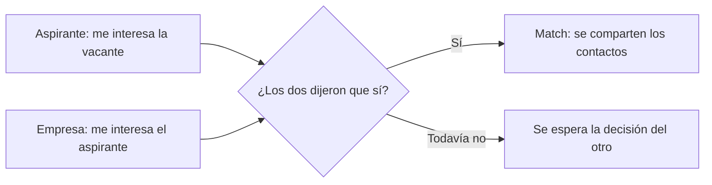

# 1. Qué hace la aplicación

Esta guía explica Empléate Jobmatch desde el punto de vista de quien la usa: qué problema resuelve, quién la usa y
qué puede hacer cada persona, paso a paso. No necesitas saber programar para leerla.

> Siguiente guía: [2. Carpetas y archivos](02-carpetas-y-archivos.md)

## Contenido

- [El problema que resuelve](#el-problema-que-resuelve)
- [La idea en una frase](#la-idea-en-una-frase)
- [Los tres roles](#los-tres-roles)
- [Recorrido del aspirante](#recorrido-del-aspirante)
- [Recorrido de la empresa](#recorrido-de-la-empresa)
- [Recorrido del administrador](#recorrido-del-administrador)
- [Funciones comunes](#funciones-comunes)
- [Reglas del negocio](#reglas-del-negocio)
- [Glosario](#glosario)

## El problema que resuelve

Buscar empleo y buscar personal suelen ser procesos lentos:

- **El aspirante** llena formularios largos, copia a mano lo que ya está en su hoja de vida y envía postulaciones
  sin saber si encaja ni si alguien las revisó.
- **La empresa** recibe muchas postulaciones que no cumplen el perfil y tiene que revisarlas una por una.
- **Los datos personales** del aspirante (teléfono, correo, hoja de vida) quedan expuestos ante empresas que quizás
  nunca se interesen en él.

Empléate Jobmatch reduce ese esfuerzo:

1. **Lee la hoja de vida** y llena el perfil automáticamente.
2. **Calcula qué tan compatible** es cada aspirante con cada vacante y explica por qué.
3. **Conecta solo cuando ambos están interesados**, como un "match".
4. **Protege los datos personales** hasta que haya ese interés mutuo.

## La idea en una frase

El aspirante marca las vacantes que le interesan y la empresa marca a los aspirantes que le interesan. **Cuando las
dos partes dicen que sí, se crea un match** y cada una recibe los datos de contacto de la otra.



No importa quién decide primero: el match se crea en el momento en que llega el segundo "sí".

## Los tres roles

| Rol | Quién es | Cómo obtiene su cuenta |
|---|---|---|
| **Aspirante** | Persona que busca empleo | Se registra desde la página **Crear cuenta** |
| **Empresa** | Organización que publica vacantes | Se registra desde la misma página, eligiendo "Empresa" |
| **Administrador** | Quien supervisa la plataforma | No hay registro público: se crea con un comando (ver la [guía 5](05-trabajo-local-y-cambios.md)) |

Al iniciar sesión, cada rol llega a su pantalla principal:

| Rol | Pantalla principal |
|---|---|
| Aspirante | **Explorar**: tarjetas de vacantes |
| Empresa | **Mis vacantes** |
| Administrador | **Resumen** del panel |

## Recorrido del aspirante

### 1. Registro con la hoja de vida

1. En **Crear cuenta** elige "Aspirante".
2. Sube su hoja de vida en PDF, Word (`.docx`), OpenDocument (`.odt`), RTF o texto (`.txt`).
3. La aplicación lee el archivo y **llena el formulario sola**: nombre, contacto, ciudad, cargo deseado, resumen,
   experiencia, estudios, habilidades e idiomas.
   - Si la IA está activa, la lectura la hace la IA.
   - Si no, usa un lector por reglas, más sencillo pero gratuito.
4. La persona **revisa y corrige** los datos, acepta los términos y crea la cuenta.

La hoja de vida no es obligatoria, pero sin ella hay que llenar todo a mano.

### 2. Explorar vacantes (tarjetas)

Es la pantalla principal del aspirante y funciona como una pila de tarjetas:

- Cada tarjeta es una vacante con su **porcentaje de compatibilidad**, la ubicación, la modalidad, el contrato, el
  salario, las habilidades pedidas y las razones a favor y en contra.
- **Me interesa**: botón ♥, deslizar a la derecha o tecla flecha derecha.
- **No me interesa**: botón ✕, deslizar a la izquierda o tecla flecha izquierda.
- **Deshacer**: botón ↺ para revertir la última decisión.
- **Filtros**: "Recomendadas" (40 % o más) o "Todas", y la modalidad (remoto, híbrido o presencial).

Solo aparecen vacantes que el aspirante todavía no ha decidido.

### 3. Buscar vacantes

Para quien prefiere una lista en lugar de tarjetas:

- Busca por **cargo, empresa o habilidad**.
- Filtra por **ciudad, modalidad, tipo de contrato, salario y compatibilidad mínima**.
- Ordena por **más compatibles**, **más recientes** o **mayor salario**.
- Al filtrar por una ciudad también aparecen las **vacantes remotas**, porque sirven desde cualquier lugar.

### 4. Detalle de una vacante y análisis con IA

Al abrir una vacante se ve toda su información. Si la IA está activa, aparece el botón **Analizar con IA**, que
explica:

- Por qué la persona encaja.
- Por qué no encaja del todo.
- Un consejo para mejorar sus posibilidades.

El análisis se guarda: abrirlo de nuevo no vuelve a gastar saldo, salvo que cambien el perfil o la vacante.

### 5. Mis matches

Tiene dos pestañas:

- **Matches**: vacantes donde la empresa también dijo que sí. Muestra el **contacto de la empresa** y una **barra
  con la etapa del proceso** (ver [Etapas después del match](#etapas-después-del-match)).
- **Me interesan**: vacantes que marcó y que esperan respuesta de la empresa.

### 6. Mi perfil

El aspirante puede:

- Editar sus datos, su experiencia, estudios, habilidades e idiomas.
- Indicar si está **buscando empleo** o no. Si no lo está, las empresas no lo ven como sugerido.
- Indicar su modalidad preferida, su aspiración salarial y si acepta trasladarse.
- **Subir una hoja de vida nueva**: la aplicación muestra qué encontró y la persona decide si lo usa.
- **Cambiar su contraseña**.
- **Eliminar su cuenta** y todos sus datos.

## Recorrido de la empresa

### 1. Registro y perfil

La empresa se registra con su nombre, NIT, sector, tamaño, ciudad, persona de contacto, correo y contraseña. En
**Empresa** puede editar esos datos y los de contacto que verán los aspirantes con los que haga match.

### 2. Mis vacantes

Muestra los indicadores de la empresa (vacantes activas, interesados por revisar y matches) y la lista de vacantes.

**Crear o editar una vacante.** El formulario pide:

| Sección | Datos |
|---|---|
| Cargo | Nombre, descripción (mínimo 30 caracteres) y requisitos |
| Ubicación y contrato | Modalidad, ciudad (no aplica si es remota), tipo de contrato y fecha de cierre opcional |
| Perfil y salario | Educación mínima, años de experiencia, salario desde y hasta, y moneda |
| Habilidades | Hasta 20, cada una marcada como **requerida** o **deseable** |

Se puede **publicar** de inmediato o **guardar sin publicar**.

**Estados de una vacante:**

| Estado | Qué significa |
|---|---|
| **Activa** | Los aspirantes la ven |
| **Pausada** | Los aspirantes no la ven, pero la empresa sigue revisando a los interesados |
| **Cerrada** | Terminó; no se ven ni se revisan candidatos |

Una vacante solo se puede **eliminar** si nadie ha interactuado con ella. Si ya tiene decisiones o matches, se
cierra en lugar de borrarse.

### 3. Candidatos

Funciona con tarjetas, igual que la exploración del aspirante:

1. Se elige una vacante.
2. Primero aparecen los **aspirantes interesados** en esa vacante y después **perfiles sugeridos**: personas que
   buscan empleo, ordenadas por compatibilidad.
3. Cada tarjeta muestra el perfil profesional, la compatibilidad y sus razones.
4. **Antes del match** solo se ve la inicial del apellido ("Laura G.") y **nunca** el correo, el teléfono ni la hoja
   de vida.
5. La empresa marca **Me interesa** o **No me interesa**, y puede deshacer.
6. Con la IA activa, puede pedir un análisis que incluye **preguntas para la entrevista**.

### 4. Matches

Muestra a los aspirantes con los que hubo match:

- Nombre completo, correo y teléfono.
- **Descarga de la hoja de vida**.
- **Selector de etapa** para registrar en qué va el proceso con esa persona.

### Etapas después del match

```text
Match  ->  En revisión  ->  Entrevista  ->  Seleccionado o Descartado
```

- La empresa cambia la etapa desde **Matches**, y puede volver atrás si se equivocó.
- El aspirante ve la misma barra en **Mis matches**, con un mensaje según la etapa.
- Al aspirante, "Descartado" se le muestra como **No seleccionado**, con un mensaje amable.

## Recorrido del administrador

| Sección | Qué permite |
|---|---|
| **Resumen** | Ver aspirantes, empresas, vacantes, matches, decisiones, uso de la IA, registros de los últimos 14 días y la actividad reciente |
| **Usuarios** | Buscar por nombre, correo o NIT; filtrar por rol y estado; **activar o desactivar** cuentas; **quitar el bloqueo** por intentos fallidos |
| **Vacantes** | Buscar y filtrar; **deshabilitar** una vacante que incumpla los términos, o volver a habilitarla |
| **Matches** | Ver todos los matches de la plataforma |
| **Actividad** | Ver la bitácora de acciones importantes y filtrarla por tipo |

Una cuenta desactivada no puede entrar y deja de aparecer en el emparejamiento. Una vacante deshabilitada deja de
verse y la empresa no puede volver a publicarla hasta que el administrador la habilite.

## Funciones comunes

- **Inicio de sesión con bloqueo:** tras 3 contraseñas incorrectas, la cuenta no puede entrar durante 15 minutos.
- **Recuperar contraseña:** se genera un enlace válido por 30 minutos y de un solo uso. Hoy, en producción, ese
  enlace queda en los registros del servidor y no llega por correo (ver
  [limitaciones](04-infraestructura-y-publicacion.md#limitaciones-de-la-infraestructura-actual)).
- **Modo claro y oscuro**, con el botón del sol o la luna.
- **Diseño para celular:** en pantallas pequeñas el menú pasa a la parte de abajo y las tablas se convierten en
  tarjetas.
- **Términos y política de datos**, que se aceptan al registrarse.

## Reglas del negocio

| Regla | Detalle |
|---|---|
| Match | Se crea cuando aspirante y empresa marcan "me interesa" para la misma vacante |
| Privacidad | Contacto y hoja de vida solo se comparten después del match |
| Decisiones | Se pueden deshacer mientras no haya match; con match activo ya no |
| Vacante visible | Activa, habilitada, sin pasar su fecha de cierre y de una empresa con cuenta activa |
| Candidatos sugeridos | Solo aspirantes que están buscando empleo y no han rechazado esa vacante |
| Contraseña | Entre 8 y 64 caracteres, con letras y números |
| Bloqueo | 3 intentos fallidos bloquean el inicio de sesión 15 minutos |
| Sesión | Dura 60 minutos; se pueden tener varias sesiones abiertas en distintos dispositivos |
| Hoja de vida | Tamaño máximo configurable (4 MB en producción) |
| Eliminar cuenta | Borra perfil, hoja de vida, decisiones, matches y datos de IA; la bitácora se conserva sin datos personales |
| Etapas | Solo la empresa dueña de la vacante cambia la etapa de sus matches |

El cálculo del porcentaje de compatibilidad se explica en la
[guía 3](03-como-funciona-por-dentro.md#cálculo-de-compatibilidad).

## Glosario

| Término | Significado |
|---|---|
| **Swipe o decisión** | Marcar "me interesa" o "no me interesa" |
| **Match** | Interés mutuo entre un aspirante y una vacante |
| **Compatibilidad** | Porcentaje de 0 a 100 que indica qué tan bien encaja un aspirante con una vacante |
| **Afinidad semántica** | Parte de la compatibilidad que calcula la IA comparando el significado de los textos |
| **Etapa** | En qué va el proceso de selección después del match |
| **Bitácora** | Registro de acciones importantes que consulta el administrador |
