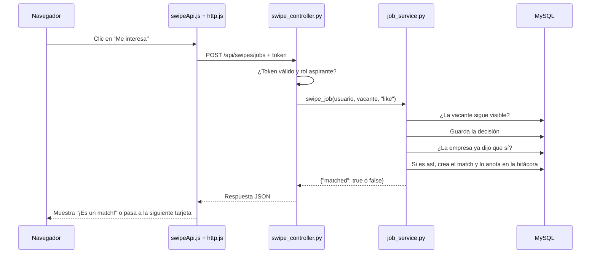
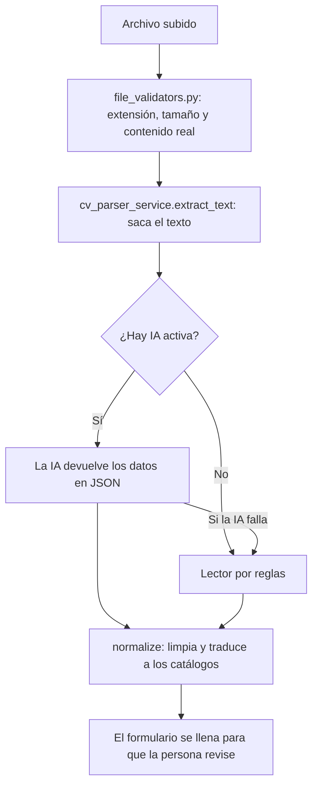
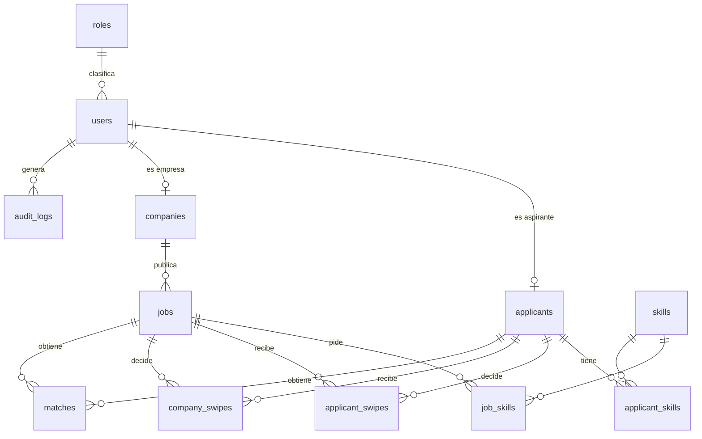

# 3. Cómo funciona por dentro

Esta guía explica cómo está construida la app: qué pasa cuando alguien pulsa un botón, cómo se organiza el código,
cómo se guarda la información y cómo funcionan la seguridad, la compatibilidad y la IA.

> Guía anterior: [2. Carpetas y archivos](02-carpetas-y-archivos.md) · Siguiente: [4. Infraestructura y publicación](04-infraestructura-y-publicacion.md)

## Contenido

- [Las tres piezas](#las-tres-piezas)
- [Recorrido de una petición](#recorrido-de-una-petición)
- [El backend por capas](#el-backend-por-capas)
- [El frontend](#el-frontend)
- [Sesiones y seguridad](#sesiones-y-seguridad)
- [Lectura de hojas de vida](#lectura-de-hojas-de-vida)
- [Cálculo de compatibilidad](#cálculo-de-compatibilidad)
- [Inteligencia artificial](#inteligencia-artificial)
- [Archivos subidos](#archivos-subidos)
- [Correos](#correos)
- [Bitácora](#bitácora)
- [Base de datos](#base-de-datos)
- [La API](#la-api)
- [Configuración](#configuración)

## Las tres piezas

| Pieza | Tecnología | Qué hace |
|---|---|---|
| **Frontend** | HTML, CSS y JavaScript sin framework | Muestra las pantallas en el navegador y llama a la API |
| **Backend** | Python con FastAPI | Aplica las reglas, valida, controla permisos y habla con la base de datos |
| **Base de datos** | MySQL | Guarda la información de forma permanente |

El frontend y el backend se hablan con **JSON** a través de una **API REST**: el navegador pide algo a una dirección
como `/api/jobs/search` y el backend responde con datos.

## Recorrido de una petición

Ejemplo: un aspirante pulsa **Me interesa** en una vacante.



Paso a paso:

1. **El controlador de la página** (`applicantSwipeController.js`) detecta el clic.
2. **La capa de API** (`swipeApi.js`) arma la petición y `http.js` le agrega el token de sesión.
3. **El controlador del backend** (`swipe_controller.py`) recibe la petición. Antes de ejecutar nada,
   `dependencies.py` valida el token y comprueba que el rol sea "aspirante".
4. **El esquema** (`SwipeRequest`) valida que los datos tengan la forma correcta: un número de vacante y una acción
   `like` o `dislike`.
5. **El servicio** (`job_service.py`) aplica las reglas: que la vacante siga visible, que no se rechace un match
   existente, guardar la decisión y crear el match si la empresa ya había dicho que sí.
6. **Los modelos** traducen esas operaciones a SQL y MySQL las guarda.
7. La respuesta vuelve en JSON y la pantalla se actualiza.

Todas las funciones de la app siguen este mismo camino.

## El backend por capas

```text
Petición  ->  Controller  ->  Schema  ->  Service  ->  Model  ->  MySQL
```

| Capa | Pregunta que responde | Ejemplo |
|---|---|---|
| **Controller** | ¿Quién llama y a qué ruta? | `PATCH /api/matches/{id}/stage` solo para empresas |
| **Schema** | ¿Los datos tienen la forma correcta? | La etapa debe ser una de las cinco permitidas |
| **Service** | ¿Qué dice la regla del negocio? | Solo la empresa dueña de la vacante cambia la etapa |
| **Model** | ¿Dónde y cómo se guarda? | Columna `stage` de la tabla `matches` |

Esta separación permite cambiar una regla sin tocar las rutas, y probar las reglas sin abrir un navegador.

### Cómo arranca el backend

`main.py` hace lo siguiente al iniciar:

1. Crea la aplicación FastAPI.
2. Activa **CORS** para los orígenes de `FRONTEND_ORIGINS`. Solo hace falta cuando las páginas se abren con Live
   Server en el puerto 5500; en producción el navegador habla con un solo sitio y no se necesita.
3. Registra los controladores de todas las rutas `/api/...`.
4. Define `/api/health`, que hace una consulta mínima a MySQL para comprobar la conexión.
5. Responde en JSON a cualquier ruta `/api/...` que no exista.
6. Si existe la carpeta `frontend/` y `SERVE_FRONTEND` está activo, sirve también las páginas. En local existe;
   en Railway no, porque solo se copia `backend/`.

### Errores

Todos los errores tienen el mismo formato, gracias a `core/exceptions.py`:

```json
{"detail": {"message": "La vacante está cerrada. Reábrela para revisar candidatos."}}
```

`http.js` toma ese `message` y lo muestra en pantalla.

### Límites por IP

`utils/helpers.py` limita algunas acciones para evitar abusos y gastos:

| Acción | Límite por IP |
|---|---|
| Leer una hoja de vida | 10 cada 10 minutos, en cada ruta que lo permite |
| Pedir recuperación de contraseña | 5 cada 15 minutos |
| Análisis con IA | 40 cada 10 minutos |

Los contadores se guardan en memoria: se reinician al reiniciar el servidor.

## El frontend

### Sin framework y sin compilación

Las páginas son HTML normales que cargan módulos de JavaScript. No hay React, Vue ni un paso de "build": el navegador
recibe los archivos tal como están en `frontend/`. Por eso Vercel solo tiene que servirlos.

### Qué pasa al abrir una página

Ejemplo: `company/matches.html`.

1. Se carga `theme.js` en el `<head>` para aplicar el modo claro u oscuro antes de pintar y evitar un parpadeo.
2. Se cargan los estilos `main.css` y `swipe.css`, más el propio del rol.
3. Se carga el módulo `companyMatchesController.js`, que:
   1. Llama a `requireRole("empresa")`. Si no hay sesión válida con ese rol, envía al inicio de sesión.
   2. Dibuja el menú con `navbar.js`.
   3. Pide los datos con `companyApi.js`.
   4. Construye la pantalla con `el()` de `dom.js`.

### Piezas clave

| Pieza | Por qué importa |
|---|---|
| `config.js` | Calcula la dirección de la API a partir de la página abierta. Por eso el mismo código funciona en local (`127.0.0.1:8000/api`) y en producción (`...vercel.app/api`) sin cambios |
| `http.js` | Centraliza todas las llamadas: agrega el token, convierte errores en mensajes y, si la sesión vence (401), la cierra y vuelve al inicio de sesión |
| `auth.js` | Guarda el token, el rol y el correo en `localStorage`, y protege las páginas por rol |
| `dom.js` | Crea elementos con `textContent`, nunca con `innerHTML`, lo que impide inyectar código con los datos de otros usuarios |
| `swipeDeck.js` | Implementa la pila de tarjetas con eventos de puntero (dedo o ratón), flechas del teclado y deshacer, sin librerías externas |

La única dependencia externa del frontend es la tipografía Nunito de Google Fonts.

## Sesiones y seguridad

### Inicio de sesión

```mermaid
sequenceDiagram
    participant N as Navegador
    participant B as Backend
    participant D as MySQL
    N->>B: POST /api/auth/login (correo y contraseña)
    B->>D: Busca el usuario
    B->>B: ¿Cuenta activa? ¿Bloqueada?
    B->>B: Compara la contraseña con su hash (bcrypt)
    alt Contraseña correcta
        B->>D: Reinicia intentos y anota el inicio de sesión
        B-->>N: Token JWT válido por 60 minutos
        N->>N: Guarda el token en localStorage
    else Contraseña incorrecta
        B->>D: Suma un intento; al tercero bloquea 15 minutos
        B-->>N: Error 401, o 423 si quedó bloqueada
    end
```

### Contraseñas

- Se guardan cifradas con **bcrypt**: ni el sistema puede ver la contraseña original.
- Deben tener entre 8 y 64 caracteres, con letras y números.
- Si el correo no existe, el mensaje es el mismo que si la contraseña está mal, para no revelar qué correos están
  registrados.

### Token de sesión (JWT)

El token es un texto firmado con `JWT_SECRET` que contiene el número de usuario, su rol y su vencimiento. En cada
petición:

1. `http.js` lo envía en la cabecera `Authorization: Bearer <token>`.
2. `dependencies.py` verifica la firma y el vencimiento.
3. Comprueba que el usuario exista y siga activo.
4. Comprueba que tenga el rol que exige la ruta.

Si el administrador desactiva una cuenta, sus sesiones dejan de funcionar en la siguiente petición. Cambiar la
contraseña no cierra las sesiones abiertas en otros dispositivos: vencen solas en un máximo de 60 minutos.

### Recuperación de contraseña

1. Se genera un enlace con un código aleatorio.
2. En la base solo se guarda la **huella** (hash) del código, nunca el código.
3. El enlace vence en 30 minutos y solo se puede usar una vez.
4. La respuesta es la misma exista o no el correo.

### Privacidad entre empresa y aspirante

Antes del match, el backend **no envía** a la empresa el correo, el teléfono, el apellido completo ni la hoja de
vida. No es algo que solo oculte la pantalla: esos datos nunca salen del servidor.

## Lectura de hojas de vida



1. **Validación:** se aceptan PDF, `.docx`, `.odt`, RTF y `.txt`. Se rechazan imágenes y el formato `.doc` antiguo,
   y se comprueba que el contenido real coincida con la extensión.
2. **Extracción del texto:** cada formato se lee con su método. Si el texto tiene menos de 40 caracteres, la app pide
   otro archivo, porque probablemente es un PDF escaneado.
3. **Interpretación:**
   - **Con IA:** se envían hasta 15.000 caracteres del texto con instrucciones para devolver nombre, contacto,
     experiencia, estudios, habilidades e idiomas.
   - **Sin IA:** un lector por reglas busca títulos de sección como "Experiencia" o "Educación".
4. **Normalización:** se quitan duplicados, se corrigen mayúsculas, se validan fechas y se convierten ciudad, nivel
   educativo e idioma a los catálogos de la base de datos.
5. El archivo queda en `uploads/tmp/`. Al terminar el registro pasa a `uploads/cvs/`. Los temporales que nadie usa se
   borran después de 24 horas.

## Cálculo de compatibilidad

`matching_service.py` da un puntaje de 0 a 100 con reglas, sin costo:

| Criterio | Puntos | Cómo se obtienen |
|---|---:|---|
| Habilidades | 50 | 40 por las requeridas y 10 por las deseables. Si la vacante no lista habilidades, se buscan las del aspirante en el texto |
| Experiencia | 15 | Proporcional a los años pedidos. Los periodos que se cruzan no se cuentan dos veces |
| Educación | 10 | Completo si alcanza el nivel mínimo; 3 si tiene estudios pero no alcanza |
| Ubicación | 15 | Completo si es remoto o en su ciudad; 8 si acepta trasladarse; 4 si es híbrido en otra ciudad |
| Modalidad | 5 | Si coincide con la preferida o no indicó preferencia |
| Salario | 5 | Completo si el salario cubre su aspiración; 3 si falta alguno de los dos datos |

Al mismo tiempo se redactan las **razones a favor y en contra**, en segunda persona para el aspirante ("Tienes 2 de 3
habilidades") y en tercera para la empresa ("Tiene 2 de 3 habilidades").

Si la IA está activa se suma la **afinidad semántica**:

```text
puntaje final = 70 % reglas + 30 % afinidad semántica
```

## Inteligencia artificial

La IA es opcional. Se activa con `AI_PROVIDER` (`openai`, `claude` o `none`) y su clave. Si falla o no hay saldo, la
app sigue funcionando con reglas.

| Función | Cómo funciona | OpenAI | Claude |
|---|---|:---:|:---:|
| **Leer hojas de vida** | El texto se envía con instrucciones para devolver JSON | Sí | Sí |
| **Afinidad semántica** | Perfil y vacante se convierten en vectores (embeddings) y se compara qué tan parecidos son | Sí | No |
| **Análisis de la pareja** | Se piden razones a favor, en contra y un consejo o preguntas de entrevista | Sí | Sí |

### Afinidad semántica, explicada

Un **embedding** es una lista de números que representa el significado de un texto. Dos textos con significado
parecido, como "programador" y "desarrollador de software", producen listas parecidas aunque usen palabras distintas.
La app compara las listas con la **similitud coseno** y convierte ese valor en puntos de 0 a 100.

### Para no pagar dos veces

- Cada vector y cada análisis se guardan con una **huella** del texto usado.
- Mientras el perfil y la vacante no cambien, se reutiliza lo guardado.
- Si la IA falla, esa función se pausa 5 minutos para no insistir y gastar.

### Qué recibe el proveedor de IA

| Función | Datos enviados |
|---|---|
| Leer hoja de vida | El texto de la hoja de vida, que puede incluir nombre y contacto |
| Afinidad y análisis | Solo el perfil profesional: cargo, resumen, habilidades, experiencia, estudios, idiomas, ciudad y modalidad. Sin nombre, correo, teléfono ni archivo |

Los modelos se configuran con `OPENAI_MODEL` (por defecto `gpt-4o-mini`), `OPENAI_EMBEDDING_MODEL`
(`text-embedding-3-small`) y `ANTHROPIC_MODEL`.

### Dos cálculos distintos

El porcentaje de las tarjetas (reglas + afinidad) y el puntaje del **Análisis con IA** no siempre coinciden. Las
reglas suman puntos por ubicación, educación, modalidad y salario. El análisis de la IA juzga sobre todo si la
experiencia encaja con el cargo.

## Archivos subidos

`storage_service.py` guarda los archivos en la carpeta indicada por `UPLOAD_DIR`:

| Carpeta | Contenido |
|---|---|
| `uploads/tmp/` | Hojas de vida recién leídas, antes de terminar el registro |
| `uploads/cvs/` | Hojas de vida definitivas |
| `uploads/logos/` | Reservada para logos de empresas |

En la base de datos solo se guarda la **ruta** del archivo. La descarga comprueba que la ruta no salga de `uploads/`
y que quien descarga sea la empresa con match.

En local la carpeta es `backend/uploads/`. En Railway es un **volumen** montado en `/app/uploads`, que conserva los
archivos aunque el servidor se vuelva a desplegar.

## Correos

`email_service.py` envía el correo de recuperación de contraseña:

- Si `SMTP_HOST` tiene un servidor, lo envía por SMTP.
- Si está vacío, imprime el correo en la consola o en los registros del servidor.

En producción, el plan de Railway bloquea SMTP, así que hoy el enlace queda en los registros.

## Bitácora

`audit_service.py` agrega un registro a `audit_logs` en la misma operación que la acción principal. Así nunca queda
una acción sin registro, ni un registro de algo que no pasó.

Se registran, entre otros: registros, inicios de sesión, bloqueos, cambios de contraseña, vacantes creadas o
cambiadas, matches, cambios de etapa y acciones del administrador. **Nunca** se guardan contraseñas, tokens ni el
contenido de las hojas de vida.

## Base de datos

`Empleate JObMatch database.sql` crea la base `jobmatch` con 25 tablas.



| Grupo | Tablas | Contenido |
|---|---|---|
| Cuentas | `roles`, `users`, `password_resets` | Usuarios, roles y enlaces de recuperación |
| Catálogos | `departments`, `cities`, `industries`, `contract_types`, `education_levels`, `languages`, `skills` | Listas que usan los formularios |
| Aspirantes | `applicants`, `applicant_experiences`, `applicant_educations`, `applicant_skills`, `applicant_languages` | Perfil profesional |
| Empresas | `companies`, `jobs`, `job_skills` | Empresas y vacantes |
| Decisiones | `applicant_swipes`, `company_swipes`, `matches` | "Me interesa", "No me interesa" y matches con su etapa |
| Caché de IA | `match_scores`, `applicant_embeddings`, `job_embeddings` | Resultados de la IA guardados |
| Actividad | `audit_logs` | Bitácora |

**Reglas que cuida la propia base:**

- Un aspirante solo tiene una decisión por vacante, y una empresa una por aspirante y vacante.
- Solo hay un match por pareja aspirante-vacante.
- Al borrar una vacante o un aspirante se borran sus decisiones y matches.

## La API

Con el backend encendido en local, la documentación interactiva de todas las rutas está en
http://127.0.0.1:8000/docs.

| Prefijo | Rutas principales | Quién |
|---|---|---|
| `/api/health` | Estado del backend y la base de datos | Público |
| `/api/auth` | `login`, `me`, `cv/parse`, `register/applicant`, `register/company`, `forgot-password`, `reset-password`, `change-password`, `account` | Público o con sesión |
| `/api/catalogs` | `cities`, `industries`, `education-levels`, `languages`, `contract-types`, `skills` | Público |
| `/api/applicant` | `profile` (ver y editar), `cv` (subir y descargar) | Aspirante |
| `/api/jobs` | `feed` (tarjetas), `search`, `{id}` (detalle) | Aspirante |
| `/api/swipes` | `jobs` y `candidates` (registrar y deshacer) | Aspirante y empresa |
| `/api/matches` | `applicant`, `company`, `{id}/stage`, `{id}/cv` | Aspirante y empresa |
| `/api/matching` | `status`, análisis por vacante y por candidato | Público el estado; con sesión el análisis |
| `/api/company` | `profile`, `jobs` (crear, editar, estado, eliminar, candidatos) | Empresa |
| `/api/admin` | `stats`, `users`, `jobs`, `matches`, `activity` | Administrador |

Códigos de respuesta habituales:

| Código | Significado |
|---|---|
| `200` / `201` | Todo bien / creado |
| `401` | Sin sesión, sesión vencida o datos de acceso incorrectos |
| `403` | Sin permiso para esa acción, o cuenta desactivada |
| `404` | No existe o ya no está disponible |
| `409` | Choca con el estado actual, por ejemplo deshacer una decisión con match |
| `413` | Archivo demasiado grande |
| `422` | Datos con formato inválido |
| `423` | Cuenta bloqueada temporalmente |
| `429` | Demasiadas peticiones seguidas |
| `500` | Error inesperado del servidor; el detalle queda en los registros |

## Configuración

`config.py` lee las variables en este orden: primero las **variables de entorno** y después `backend/.env`. Por eso,
en una terminal, `$env:DB_HOST=...` tiene prioridad sobre el `.env`, y en Railway mandan sus variables.

| Variable | Uso | Valor por defecto |
|---|---|---|
| `DB_HOST`, `DB_PORT`, `DB_USER`, `DB_PASSWORD`, `DB_NAME` | Conexión con MySQL | `localhost`, `3306`, obligatorio, obligatorio, `jobmatch` |
| `JWT_SECRET` | Firma de las sesiones | Obligatoria |
| `JWT_EXPIRE_MINUTES` | Duración de la sesión | `60` |
| `MAX_LOGIN_ATTEMPTS`, `LOCK_MINUTES` | Bloqueo por intentos | `3`, `15` |
| `SERVE_FRONTEND` | El backend sirve las páginas | `true` |
| `FRONTEND_URL` | Dirección usada en el enlace de recuperación | `http://127.0.0.1:8000` |
| `FRONTEND_ORIGINS` | Orígenes permitidos para Live Server | Puerto 5500 local |
| `RESET_TOKEN_MINUTES` | Duración del enlace de recuperación | `30` |
| `SMTP_HOST`, `SMTP_PORT`, `SMTP_USER`, `SMTP_PASSWORD`, `SMTP_FROM`, `SMTP_USE_TLS` | Envío de correos | Sin servidor: se imprime |
| `UPLOAD_DIR` | Carpeta de archivos | `backend/uploads` |
| `MAX_CV_MB` | Tamaño máximo de la hoja de vida | `5` |
| `AI_PROVIDER` | Proveedor de IA | `none` |
| `OPENAI_API_KEY`, `OPENAI_MODEL`, `OPENAI_EMBEDDING_MODEL` | OpenAI | Clave vacía |
| `ANTHROPIC_API_KEY`, `ANTHROPIC_MODEL` | Claude | Clave vacía |
| `AI_MATCHING_ENABLED` | Activa el emparejamiento con IA | `true` |
| `AI_TIMEOUT_SECONDS` | Espera máxima a la IA | `60` |
