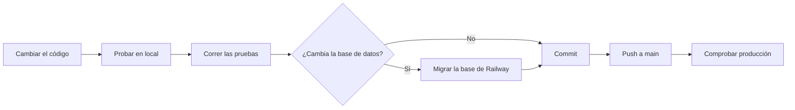

# 5. Trabajo local y publicación de cambios

Esta guía explica cómo preparar tu computador, arrancar la app en local, probarla y llevar un cambio a producción
sin romper nada.

> Guía anterior: [4. Infraestructura y publicación](04-infraestructura-y-publicacion.md)

## Contenido

- [Qué necesitas instalar](#qué-necesitas-instalar)
- [Primera instalación](#primera-instalación)
- [Arrancar la app cada día](#arrancar-la-app-cada-día)
- [Datos de prueba en local](#datos-de-prueba-en-local)
- [Activar la IA en local](#activar-la-ia-en-local)
- [Pruebas automáticas](#pruebas-automáticas)
- [Llevar un cambio a producción](#llevar-un-cambio-a-producción)
- [Cambios en la base de datos](#cambios-en-la-base-de-datos)
- [Agregar una variable de configuración](#agregar-una-variable-de-configuración)
- [Lista antes de una presentación](#lista-antes-de-una-presentación)
- [Problemas comunes en local](#problemas-comunes-en-local)

## Qué necesitas instalar

| Programa | Para qué |
|---|---|
| **Python 3.14** | Ejecutar el backend. Es la misma versión que usa Railway |
| **MySQL 8** y **MySQL Workbench** | La base de datos local y una ventana para consultarla |
| **Git** | Guardar cambios y subirlos a GitHub |
| **Visual Studio Code** u otro editor | Editar el código |
| Un navegador | Usar la app |

## Primera instalación

### 1. Crear la base de datos local

1. Abre MySQL Workbench y conéctate a tu MySQL local.
2. Abre `Empleate JObMatch database.sql` con **File > Open SQL Script**.
3. Ejecútalo con el botón del rayo.

Se crea la base `jobmatch` con sus tablas y catálogos.

### 2. Crear el archivo de configuración

1. Copia `backend/.env.example` y nombra la copia `backend/.env`.
2. Cambia al menos estos valores:

| Variable | Qué poner |
|---|---|
| `DB_USER` y `DB_PASSWORD` | El usuario y la contraseña de **tu** MySQL local |
| `JWT_SECRET` | Una clave aleatoria. Puedes generarla con el comando de abajo |

```powershell
python -c "import secrets; print(secrets.token_hex(32))"
```

`.env` nunca se sube a GitHub: tiene tus contraseñas.

### 3. Crear el entorno virtual e instalar las librerías

El **entorno virtual** (`venv`) es una carpeta con las librerías de este proyecto, separada del resto de tu
computador. Así cada proyecto tiene sus propias versiones.

Abre PowerShell en la carpeta `backend/`:

```powershell
cd C:\Users\david\Proyectos\Empleate-JobMatch\backend
```

```powershell
python -m venv venv
```

```powershell
.\venv\Scripts\python.exe -m pip install -r requirements.txt
```

Si `venv` se daña, puedes borrar la carpeta y repetir estos dos comandos.

### 4. Cargar las habilidades y crear el administrador

```powershell
.\venv\Scripts\python.exe -m scripts.migrate_skills_catalog
```

```powershell
.\venv\Scripts\python.exe -m scripts.create_admin admin@tucorreo.com
```

El segundo comando pide una contraseña; mientras la escribes no se ve nada, y es normal.

## Arrancar la app cada día

1. Asegúrate de que tu MySQL local esté encendido.
2. En PowerShell, dentro de `backend/`:

   ```powershell
   .\venv\Scripts\python.exe -m uvicorn main:app --reload
   ```

3. Abre http://127.0.0.1:8000.

`--reload` reinicia el servidor cada vez que guardas un archivo de Python. Los cambios en HTML, CSS o JavaScript solo
necesitan recargar la página. Para detener el servidor, pulsa **Ctrl + C** en la ventana de PowerShell.

| Dirección local | Qué es |
|---|---|
| http://127.0.0.1:8000 | La app |
| http://127.0.0.1:8000/docs | Documentación interactiva de la API |
| http://127.0.0.1:8000/api/health | Estado del backend y la base de datos |

No abras los archivos `.html` con doble clic: el navegador bloquea los módulos de JavaScript en `file://`.

## Datos de prueba en local

Para tener empresas y vacantes de ejemplo **solo en tu computador**:

```powershell
.\venv\Scripts\python.exe -m scripts.seed_demo
```

Crea 3 empresas y 12 vacantes, que entran con la contraseña conocida `Demo1234`. Para borrarlas:

```powershell
.\venv\Scripts\python.exe -m scripts.seed_demo --borrar
```

**Nunca lo ejecutes contra producción:** cualquiera que conozca esa contraseña podría entrar como esas empresas.

## Activar la IA en local

Agrega a `backend/.env`:

```env
AI_PROVIDER=openai
OPENAI_API_KEY=tu_clave
```

Reinicia `uvicorn`. Sin estas líneas, la app funciona con reglas y no gasta saldo.

## Pruebas automáticas

Desde `backend/`:

```powershell
.\venv\Scripts\python.exe -m pytest
```

- Usan una base SQLite temporal: **no tocan tu MySQL** ni servicios externos.
- Si todo está bien, al final aparece `... passed`.
- Si algo falla, el mensaje indica el archivo, la prueba y la línea.

Ejecútalas antes de subir cualquier cambio.

## Llevar un cambio a producción

**La regla clave:** guardar archivos o hacer `commit` solo afecta tu computador. Producción cambia cuando el código
llega a la rama `main` de GitHub.



### Paso a paso

1. **Haz el cambio** y pruébalo en http://127.0.0.1:8000.
2. **Corre las pruebas** con `pytest`.
3. **Revisa qué cambió:**

   ```bash
   git status
   ```

4. **Agrega solo los archivos de ese cambio.** Nombra cada archivo: evita `git add .` si tienes otros cambios a
   medias, porque se irían en el mismo commit.

   ```bash
   git add frontend/assets/js/components/aiAnalysis.js
   ```

5. **Crea el commit** con un mensaje que explique el cambio:

   ```bash
   git commit -m "Explica en una frase qué cambió"
   ```

6. **Súbelo:**

   ```bash
   git push origin main
   ```

7. **Comprueba producción:**
   - Vercel publica en menos de un minuto.
   - Railway tarda unos minutos y detiene el backend unos instantes.
   - Abre `/api/health` y prueba la función que cambiaste.

### Ramas (opcional)

Para cambios grandes conviene trabajar en una rama aparte y unirla a `main` cuando esté lista:

```bash
git switch -c nombre-del-cambio
```

Recuerda que una rama subida puede generar una página de prueba en Vercel, y esa página usa **la base de datos de
producción**.

## Cambios en la base de datos

Agregar una columna o una tabla requiere más cuidado, porque **el push no cambia la base de Railway**. Si el código
nuevo llega antes que la columna, la app falla.

Así se hizo con las etapas del proceso, y así conviene hacerlo siempre:

1. **Actualiza el modelo** en `backend/app/models/`.
2. **Actualiza `Empleate JObMatch database.sql`**, para que una base nueva nazca completa.
3. **Escribe un script de migración** en `backend/scripts/`, que:
   - revise si la columna ya existe antes de crearla;
   - corrija su tipo si quedó mal;
   - se pueda ejecutar varias veces sin dañar nada.
4. **Ejecútalo en tu base local** y prueba la app.
5. **Ejecútalo contra la base de Railway** siguiendo
   [Ejecutar un script contra producción](04-infraestructura-y-publicacion.md#ejecutar-un-script-contra-producción).
6. **Sube el código** solo después de que la migración haya terminado bien.
7. **Prueba la función en producción.** Si falla, revisa **Deploy Logs**: un error de tipo de columna aparece como
   `Data truncated for column ...`.

## Agregar una variable de configuración

1. Agrégala a `backend/app/config.py`, con un valor por defecto si es opcional.
2. Agrégala a `backend/.env.example` con un valor de ejemplo, **sin secretos**.
3. Agrégala a tu `backend/.env`.
4. Agrégala en Railway, en el recuadro del backend, pestaña **Variables**, y despliega.

## Lista antes de una presentación

**El día anterior:**

- [ ] Revisa el saldo y la fecha de la prueba en Railway.
- [ ] Comprueba que MySQL tenga **Serverless desactivado**.
- [ ] Prueba con cuentas de prueba el recorrido completo: registro, match, cambio de etapa y análisis con IA.

**30 minutos antes:**

- [ ] Desactiva **Serverless** en `Empleate-JobMatch`.
- [ ] Abre https://empleate-jobmatch-frontend.vercel.app/api/health y comprueba `"database":"connected"`.
- [ ] Inicia sesión una vez con cada rol que vayas a mostrar.

**Durante la demostración:**

- [ ] No muestres "Olvidé mi contraseña": en producción el enlace no llega por correo.
- [ ] Si algo falla una vez, recarga: la primera petición tras un rato sin uso puede fallar.

**Después:**

- [ ] Vuelve a activar **Serverless** en el backend para ahorrar saldo.

## Problemas comunes en local

| Mensaje o síntoma | Causa | Solución |
|---|---|---|
| `Access denied for user 'root'@'localhost'` | La contraseña de `backend/.env` no coincide con tu MySQL | Corrige `DB_PASSWORD` en `.env` |
| `Can't connect to MySQL server on 'localhost'` | MySQL no está encendido | Inícialo desde Servicios de Windows o MySQL Workbench |
| `No module named ...` | Se ejecutó Python sin el entorno virtual | Usa `.\venv\Scripts\python.exe` |
| `The term '.\venv\Scripts\python.exe' is not recognized` | La ventana no está en la carpeta `backend` | Ejecuta primero `cd ...\Empleate-JobMatch\backend` |
| Algo sobre `JWT_SECRET` o `DB_USER` | Faltan variables en `.env` | Revisa que `.env` exista en `backend/` y tenga esos valores |
| La página carga pero sin datos | Abriste el `.html` con doble clic | Abre http://127.0.0.1:8000 |
| `address already in use` | Ya hay otro `uvicorn` encendido | Ciérralo con Ctrl + C o usa otra ventana |
| Un comando afectó la base de producción | La ventana tenía variables `$env:DB_...` de Railway | Cierra esa ventana y abre una nueva |
